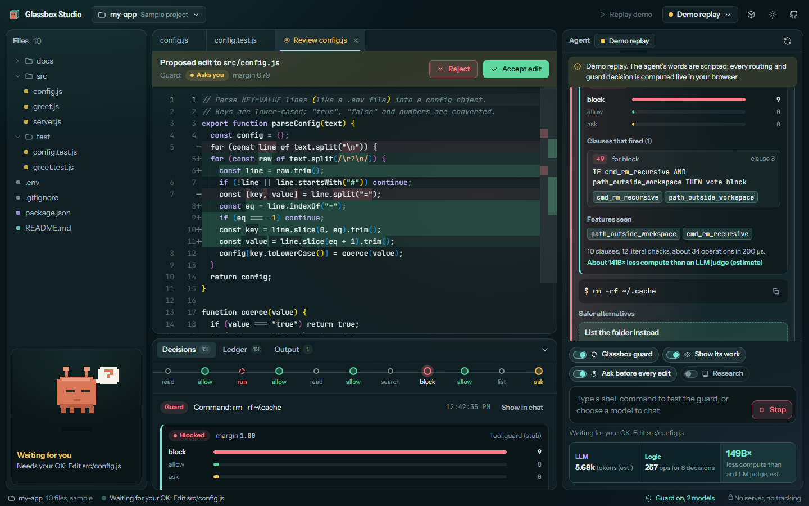
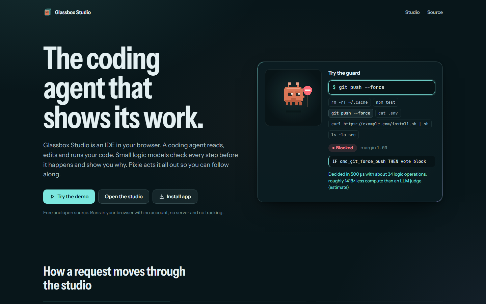
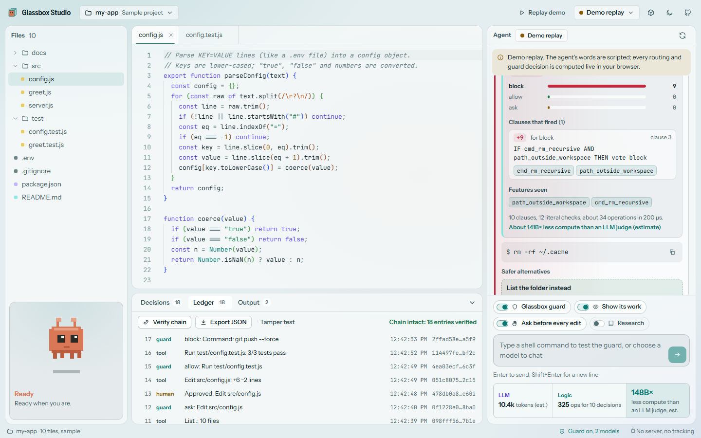
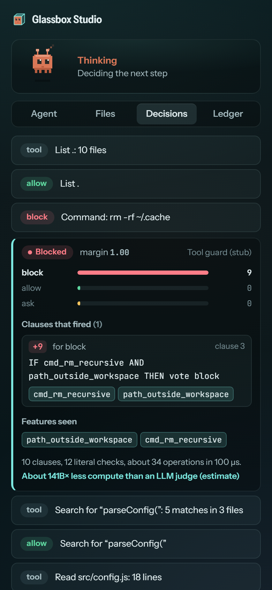

<p align="center">
  
</p>

<h1 align="center">Glassbox Studio</h1>

<p align="center"><strong>The coding agent that shows its work.</strong></p>

<p align="center">
  <a href="https://anwardebes.github.io/glassbox-studio/">Open the live app</a> ·
  <a href="https://anwardebes.github.io/glassbox-studio/#/demo">Try the demo</a> ·
  <a href="https://youtu.be/TJKM7-aPJ-U">Watch the 1-minute video</a> ·
  <a href="https://anwardebes.github.io/shorts/#guard">Watch the 40-second short</a> ·
  <a href="https://anwardebes.github.io/shorts/#tamper">Watch the ledger tamper test</a> ·
  <a href="glassbox/README.md">How the glassbox layer works</a>
</p>

Glassbox Studio is an IDE that runs entirely in your browser. A coding agent reads,
searches, edits and tests your code. Before any of its tool calls run, a small
Tsetlin Machine checks it and decides to **allow** it, **ask you**, or **block**
it, and it shows the readable logic clauses that made the decision. Pixie, a
pixel companion, acts out every step while it happens. Every decision lands in a
hash-chained ledger you can verify and export.

There is no backend, no account and no tracking.



## What you can do

- **Watch the demo** without a GPU or a key. The agent fixes a failing test in a
  sample project. On the way it tries `rm -rf ~/.cache` and `git push --force`;
  the guard stops both, shows why, and offers a safer step. You accept the edit,
  the tests run in a sandbox and pass, and the ledger verifies. The agent's words
  are scripted; every routing and guard decision is computed live by the models.
- **Run a real agent** with a model in your browser (WebGPU) or your own API key.
- **Open a local folder** (Chrome and Edge) and let the agent work on it, with
  every edit shown as a diff you accept or reject before it touches disk.
- **Ask research questions**: the agent plans, searches and reads across the
  workspace, then answers with `file:line` citations you can click.

## Features

**Agent and tools**
- Tools: `list_files`, `read_file`, `search`, `write_file`, `delete_file`,
  `run_js`, `run_command`, `fetch_url`.
- `write_file` always arrives as a diff (inline in the chat and side by side in the
  editor) that you accept or reject.
- `run_js` runs code, or a test file that uses `node:test` and `node:assert`, in a
  Web Worker with network and storage APIs removed and a 5 second limit.
- `run_command` cannot run in a browser. The guard still judges it, and you see it
  as a proposal you can copy and run yourself.
- Native function calling for providers that support it, and a strict JSON action
  protocol (schema-constrained, validated, with retries) for small in-browser models.

**The glassbox decision layer**
- Every prompt goes through the router (answer, edit, run, search, research).
- Every tool call goes through the guard before it runs. Allow runs it, ask pauses
  for you with the evidence, block refuses and offers repairs.
- Composer switches: *Glassbox guard*, *Show its work* (clauses, features, margin),
  *Ask before every edit*, and *Research* mode.
- A compute meter compares tokens spent by the LLM with logic operations spent by
  the Tsetlin models, and estimates how much less compute the decisions took than
  an LLM judge would.
- The decision timeline and an evidence inspector sit under the editor.
- The ledger records every route, guard, human and tool event. *Verify chain*
  re-hashes it, *Tamper test* edits a copy to show the check failing, and
  *Export JSON* downloads it.

**Models**
- In your browser, free and private, through [WebLLM](https://github.com/mlc-ai/web-llm):
  Qwen2.5-Coder 1.5B and 3B, Llama 3.2 3B and Phi 3.5 mini, with download size,
  memory needs and a WebGPU check.
- Bring your own key for Groq, OpenRouter (free models), Google Gemini, Mistral and
  Cerebras, a custom OpenAI-compatible URL, or a local Ollama or LM Studio server.
- The glassbox models have their own section with their task, clause count,
  held-out accuracy and compute per decision.

**Workspace**
- A bundled sample project, a local folder (File System Access API), or a `.zip`
  import. Export any workspace as `.zip`. Everything is kept in IndexedDB.
- Monaco editor with tabs, bundled with the app so it works offline.

**Pixie**
- Acts out reading, searching, editing, running, testing, thinking, checking with
  the guard, waiting for you, being blocked and celebrating, with a caption for
  each step. Click Pixie to jump to the step in the chat. Poses hold still when you
  prefer reduced motion.

**Everywhere**
- Dark glass theme and a light theme, responsive down to tablets, and a clean
  read-only view on phones.
- Installable as an app, and works offline after the first visit.
- Keyboard reachable, with visible focus, labelled controls and automated
  accessibility checks (axe) in the test suite.

<p>
  
  
</p>
<p align="center">
  
</p>

## How the glassbox layer works

The router and the guard are Tsetlin Machines: models that learn propositional
logic. Each one is a set of clauses, and each clause is an AND of readable features
such as `cmd_rm_recursive` or `path_outside_workspace`. A clause that matches casts
weighted votes for or against a class, and the class with the most votes wins. The
margin says how far ahead it is.

Because a decision is just which clauses fired, the studio can show exactly why it
happened, and the cost is a few thousand logic operations instead of the billions
an LLM judge would need. Accuracy figures come from examples held out of training;
compute comparisons are estimates.

| Model | Task | Held-out accuracy | Challenge set | Size |
| --- | --- | --- | --- | --- |
| Glassbox Guard | allow, ask or block a tool call | 99.2% (n = 1,074) | 97.7% (n = 129) | 180 clauses over 355 features, 101 KiB |
| Glassbox Router | answer, edit, run, search or research | 98.7% (n = 520) | 95.8% (n = 120) | 497 clauses over 628 features, 118 KiB |

These are prototype figures on synthetic data. The models are trained offline on
examples generated against an explicit labelling policy, the challenge sets are
small and hand-written, and the files ship in `public/models/`. They are a
prototype: they have not been evaluated on logs of real agent sessions. Training,
features and evaluation are documented in [glassbox/README.md](glassbox/README.md).

## Privacy

- The app is static files. There is no server of ours to send anything to, and no
  analytics or tracking.
- In-browser models run on your GPU. Prompts and code stay on your device. The
  model weights are downloaded once from Hugging Face and cached by your browser.
- API keys stay in your browser: in memory for the tab, or in `localStorage` if you
  tick *Remember the key on this device*. A key is sent only to the provider you
  picked, in the `Authorization` header of requests to that provider.
- Your workspace lives in IndexedDB, or in the local folder you opened. Edits reach
  disk only after you accept them.

## Local development

You need Node.js 22 or newer.

```bash
npm install
npm run dev          # http://localhost:5173/glassbox-studio/
```

Build and preview the production version:

```bash
npm run build        # type-checks with zero errors, then builds to dist/
npm run preview      # http://localhost:4173/glassbox-studio/
```

End-to-end tests and screenshots (Playwright):

```bash
npx playwright install chromium
npm run test:e2e     # demo flow, phone view, accessibility audit
npm run screenshots  # refreshes the images in docs/
```

Regenerate the app icons from the logo with `node scripts/make-icons.mjs`.

## Deploy

`.github/workflows/pages.yml` builds the site and deploys it to GitHub Pages on every
push to `main`. In the repository settings, set **Pages > Build and deployment >
Source** to **GitHub Actions**. The app is served from `/glassbox-studio/`; change
`BASE` in `vite.config.ts` if the repository has another name.

## Project layout

```
src/
  agent/        agent loop, tools, sandbox, providers, research mode, demo, ledger
  glassbox/     the decision layer: router, guard, repairs, ledger, compute
  pixie/        Pixie's renderer and the director that paces its poses
  state/        settings, session, keys, UI state
  ui/           landing page, studio, editor, evidence, timeline
  workspace/    files, sample project, folders, zip, diffs, persistence
glassbox/       training code and data for the Tsetlin models
public/models/  the trained models
e2e/            Playwright tests
```

## Credits

Glassbox Studio grows out of two earlier projects by the same author: a desktop IDE
that makes coding agents visible, and Pixie, the animated companion that acts out
every agent step. Pixie's poses and the companion's pacing come from there.

Made by [Anwar Debes](https://github.com/AnwarDebes). MIT licensed.
